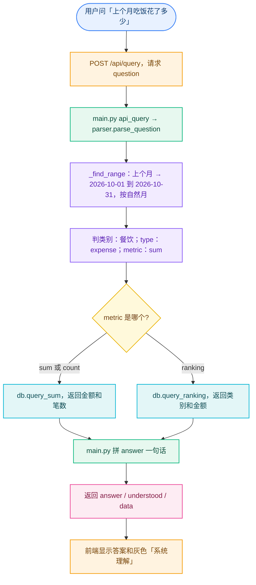

# 整体流程（契约 v2）

> 最后更新：2026-11-18
> 口径以 `contract.py` 第 59 行以下的 v2 为准：日期 `'YYYY-MM-DD'` 必须补零，金额一律整数「分」，类别 8 个，收支只有 `expense` / `income`，流水表名 `transactions`。
> 本文画的是「一次记账」和「一次查账」两条主链路，以及 11 条接口各自落在哪一层。

---

## 一、记账

从用户在网页敲一句话，到这笔账落进数据库。

```mermaid
%% 配色约定：一个颜色代表一层，读图先看颜色就知道卡在哪一层
%% 蓝=入口  橙=前端  绿=后端路由  紫=解析  粉=返回给前端的东西  青=数据  黄=判断  红=告警
flowchart TD
  U(["用户输入「昨天打车 32 块」"]):::entry --> A1["app.js 输入框"]:::front
  A1 --> A2["POST /api/parse，请求 text"]:::front
  A2 --> R1["main.py api_parse"]:::api
  R1 --> P1["parser.parse_text"]:::parse
  P1 --> P2["① 认日期「昨天」→ 2026-11-17，并把「昨天」从文本里抠掉"]:::parse
  P2 --> P3["② 在剩下的文本里找金额：32块 → 3200 分"]:::parse
  P3 --> P4["③ 关键词打分判类别：打车 → 交通"]:::parse
  P4 --> P5["④ 判收支：没有收入词 → expense；抽商家：没有 → 空串"]:::parse
  P5 --> OUT["返回 day / amount 3200 / type / category / merchant / note / understood"]:::out
  OUT --> A3["确认卡片：understood 为 false 的字段标黄，让用户补"]:::front
  A3 -->|用户点确认| A4["POST /api/transactions，六个字段"]:::front
  A4 --> R2["main.py api_create：缺 day/amount/type/category 就返回 400"]:::api
  R2 --> D1["db.add_row，六个参数"]:::data
  D1 --> D2[("transactions 表，amount 是 INTEGER 分")]:::data
  D2 --> D3["main.py 调 month_summary 和 get_budget"]:::api
  D3 --> W{"本月这个类别已经超预算?"}:::decision
  W -->|是| A5["toast 提示超支：库里 24750 分，前端显示 ¥247.50"]:::warn
  W -->|否| A6["GET /api/summary、/api/transactions、/api/categories"]:::front
  A5 --> A6

  classDef entry fill:#E8F1FF,stroke:#3B82F6,stroke-width:1.5px,color:#0B3B6F
  classDef front fill:#FFF3E0,stroke:#F59E0B,stroke-width:1.5px,color:#7A4500
  classDef api fill:#E7F8EF,stroke:#10B981,stroke-width:1.5px,color:#064E3B
  classDef parse fill:#F2EBFF,stroke:#8B5CF6,stroke-width:1.5px,color:#5B21B6
  classDef out fill:#FDECF3,stroke:#EC4899,stroke-width:1.5px,color:#831843
  classDef data fill:#E3F6F7,stroke:#06B6D4,stroke-width:1.5px,color:#0E4F57
  classDef decision fill:#FFF9DB,stroke:#EAB308,stroke-width:1.5px,color:#713F12
  classDef warn fill:#FFEBEE,stroke:#EF4444,stroke-width:1.5px,color:#7F1D1D
```

**为什么第 ① 步要先抠掉日期**

`「11月13日 打车 30」` 里有 11、13、30 三个数字。如果直接「找第一个数字当金额」，拿到的是 11，金额会变成 1100 分，而且不报错。必须先把「11月13日」整段从文本里删掉，剩下的 `「 打车 30」` 里才只剩一个数字。

**金额在四层里的形态**

| 层 | 形态 | 例子 |
| --- | --- | --- |
| 用户输入 | 文本 | `30块` |
| `parser` 返回 | 整数分 | `3000` |
| `db` 存取 | 整数分 | `3000` |
| 前端显示 | 分除以 100 | `¥30.00` |

全程不出现 `float`。`REAL` 是浮点数，`0.1 + 0.2 = 0.30000000000000004`，攒几百笔之后合计会变成 `832.9999999`。整数分从根上没有这个问题，代价只在显示时除一次 100。

---

## 二、查账

从一句问题，到一条 SQL 条件，再到一句答案。

**为什么不让模型算钱**

`parse_question` 只输出 `{from, to, category, type, metric}`，金额一律由 SQL 算。同一个问题问两遍，答案一定一样；错了也能查到是哪一层错的——是日期区间理解错了，还是类别判错了，还是 SQL 漏了 `type` 条件。界面上那行灰色的「系统理解」把条件直接给用户看，理解错了当场就能发现。

**「上个月」为什么必须是自然月**

`today - 30 天` 在 11 月 17 日会得到 10 月 18 日，而「上个月」应该从 10 月 1 日算起。两者差 17 天，月底那几笔账会静默漏掉。所以 `_find_range` 对「上个月 / 本月」都按自然月首尾算，只有「最近 30 天」才是滚动 30 天。

---

## 三、11 条接口总览

| # | 方法 | 路径 | 做什么 | 落到哪个函数 |
| --- | --- | --- | --- | --- |
| 1 | POST | `/api/parse` | 解析一句话，返回候选账目 | `parser.parse_text` |
| 2 | POST | `/api/transactions` | 记一笔 | `db.add_row` |
| 3 | GET | `/api/transactions` | 流水，支持分页和筛选 | `db.list_rows` + `db.count_rows` |
| 4 | DELETE | `/api/transactions/{id}` | 删一笔 | `db.delete_row` |
| 5 | GET | `/api/summary` | 某月支出、收入、结余、笔数 | `db.month_summary` |
| 6 | GET | `/api/categories` | 分类合计，补满 8 类 | `db.category_totals` + 路由层补零 |
| 7 | GET | `/api/trend` | 每日折线，补满整月 | `db.daily_totals` + 路由层补天 |
| 8 | POST | `/api/query` | 一句话查账 | `parser.parse_question` + `db.query_sum` / `db.query_ranking` |
| 9 | GET | `/api/budget` | 预算和已用 | `db.list_budgets` + `db.query_sum` |
| 10 | PUT | `/api/budget` | 设置预算 | `db.set_budget` |
| 11 | GET | `/api/meta` | 类别清单、收入常量、今天 | `parser` 的常量 |

**第 6、7 条的补零和补天为什么在 `main.py`**

`GROUP BY` 只对存在的行分堆。一条购物记录都没有，库里就没有「购物」这一堆，接口少返回一个类别，前端柱子凭空少一根而且不报错。同理，某天没记账，折线图就会断。补零和补天是业务知识，属于路由层；`db.py` 只回答「库里有什么」，不替业务猜。

---

## 四、三条分界线

| 分界线 | 两边各管什么 | 好处 |
| --- | --- | --- |
| fetch 那一层 | 前端只发请求、画页面；路由只接参数、调函数、返 JSON | 换界面不动后端 |
| 解析 / 入库 | 解析只出候选，不碰库；入库只在用户确认后发生 | 解析猜错不落库，人还拦得住 |
| 理解 / 计算 | 理解只输出条件；金额 SQL 算；拼句子只做字符串 | 答案可复现、可审计 |

---

## 五、v1 到 v2 变了什么

| 项 | v1 | v2 |
| --- | --- | --- |
| 金额 | `REAL` 浮点元 | `INTEGER` 整数分 |
| 类别 | 5 类 | 8 类中文键（含「其他」），收入固定「收入」 |
| 流水字段 | day / amount / category / note | 增加 `type`、`merchant` |
| 接口 | 9 条 | 11 条（新增 `/api/trend`、`/api/meta`） |
| 解析返回 | `source` | `understood`（哪些字段是认到的） |
| 预算 | 按 `month` 一行 | 按 `(month, category)` 复合主键 |

---

## 六、五个人怎么并行

每一段之间靠 `contract.py` 里写死的形状相连。形状不变：

- A 可以在 B、C 都没写完时，用假数据把自己那段先做完；
- B 和 C 可以互不知道对方在干什么；
- 组长只需要在最后把真函数接进路由，前端一行不用改；
- 一人一个文件：`contract.py` 和 `main.py` 归组长，`parser.py` 归 B，`db.py` 归 C，`frontend/` 归 A。谁都不改别人的文件，合并才不会冲突，review 才有边界。
