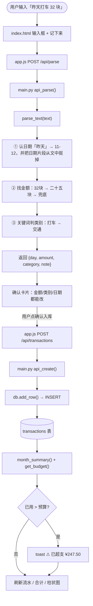
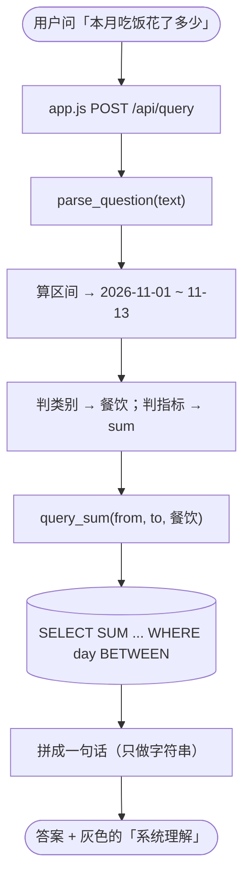

# 整体流程

从用户在网页敲一句话，到这笔账落进数据库。

## 一、记账

**为什么第 ① 步要先抠掉日期**
「11月5日买菜30」里有 11、5、30 三个数字。不先把「11月5日」从文本里删掉，
「全文只剩一个数字就当金额」这条兜底永远不成立，金额会被认成 11。

## 二、查账

**为什么不让模型算钱**
模型只输出 `{from, to, category, metric}`，金额一律由 SQL 算。
同一个问题问两遍，答案一定一样，而且错了能查到是哪一层错的。
界面上那行「系统理解」把条件直接给用户看，理解错了当场就能发现。

## 三、三条分界线

| 分界线 | 两边各管什么 | 好处 |
| --- | --- | --- |
| fetch 那一层 | 前端只发请求、画页面；路由只接参数、调函数、返 JSON | 换界面不动后端 |
| 解析 / 入库 | 解析只出候选，不碰库；入库只在用户确认后发生 | 模型猜错不落库，人还拦得住 |
| 理解 / 计算 | 理解只输出条件；金额 SQL 算；拼句子只做字符串 | 答案可复现、可审计 |

## 四、五个人怎么并行

每一段之间靠 `contract.py` 里写死的形状相连。形状不变：

- A 可以在 B、C 都没写完时，用假数据把自己那段先做完
- B 和 C 可以互不知道对方在干什么
- 组长只需要在最后把真函数接进路由，前端一行不用改
